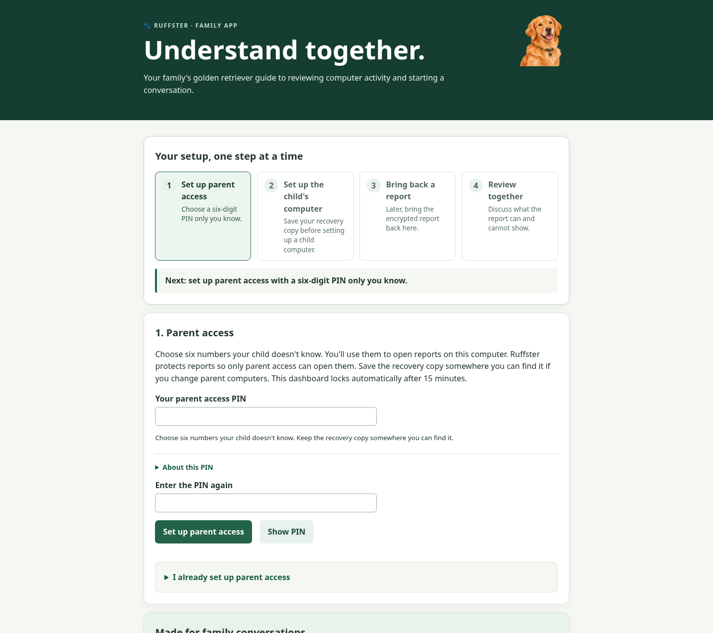
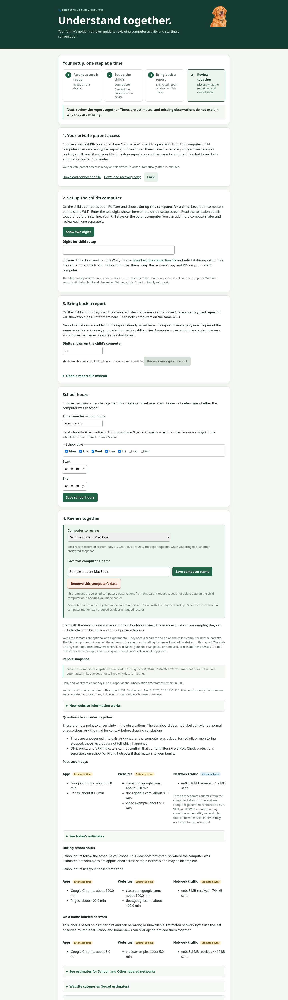

# Ruffster

**Make computer use easier to talk about.** Ruffster is an open-source prototype for parents and children to review computer use together, with visible monitoring, local reports, and explicit limits on what the data can tell you. Its golden retriever mascot stands for a friendly family companion: present, easy to understand, and never there to judge.

<p align="center"></p>

**This is not ready for family deployment.** The Mac package is unsigned. Windows has not been tested on a Windows computer. Setup, accessibility, security, key recovery, and family usability still need validation. Any Mac download will be an unsigned development preview, clearly marked as such; macOS will warn before opening it. There is no supported family release download.

[Website source (Pages-ready)](docs/index.html) · [Getting started](docs/install.html) · [Progress page](docs/progress.html) · [FAQ](docs/faq.html) · [Privacy and children's rights](PRIVACY-AND-CHILDREN.md) · [Implementation plan](PLAN.md) · [Current status](PROJECT-STATUS.html)

> **Platform priority:** macOS first, then Windows. Linux is a development and test host only; Linux is not a student-facing target in the current scope.

## A look at the prototype

These full-page captures show the local parent dashboard's first-run PIN setup and a sample report. The report uses synthetic data only; no child's activity appears in these images. Select either image to view it at full size.

<p align="center">
  <a href="docs/assets/parent-setup.png"></a>
  &nbsp;
  <a href="docs/assets/parent-dashboard.png"></a>
</p>

<p align="center"><sub>First-run parent PIN setup · synthetic report with measurement notes</sub></p>

## Product principles

- **Visible, disclosed monitoring.** The computer user should be able to see when the agent is active and understand what it collects.
- **Conversation, not control.** The app does not block applications or score a child's behavior.
- **Local by default.** The child agent encrypts each observation to a public key supplied by the parent. The matching private key stays with the parent.
- **Careful language.** Estimates remain estimates. Missing observations, unfamiliar networks, and configuration indicators are not evidence of intent.
- **Minimal collection.** No screenshots, keystrokes, audio, camera, message contents, or full website URLs.

## What the prototype can show

| Observation | Current behavior | Limit |
| --- | --- | --- |
| Foreground application | Sampled application name | Time between matching samples is only an estimate and may include idle time. |
| Network traffic | Today and past-seven-day sums of recorded byte-counter changes per interface, plus estimated school-hour and Home-, School-, and Other-labeled network breakdowns. macOS also offers an opt-in experimental process-byte summary. | Schedule estimates apportion interface intervals by the chosen hours; router estimates use the last parent-labeled hint. Interfaces may overlap and intervals may be missed. Optional process totals can be assigned to helper services, miss short connections, and do not identify websites. |
| Monitoring coverage | Sessions, heartbeats, and observable gaps; the Mac menu-bar and Windows tray companions show starting, recent-sample, and overdue states from completed encrypted samples. The Mac helper exposes explicit screen-reader labels and help. | A gap does not establish whether the cause was sleep, a crash, permissions, removal, or something else. The Windows indicator has not run on Windows; the rendered Mac menu item and actual VoiceOver behavior still need interactive review. |
| Network changes | Mac setup records a pseudonymous hint when the default router changes; the experimental Windows preview is wired to do the same. The raw router address is not saved. | Windows PowerShell behavior has not been verified on a Windows computer. A router hint is not proof of location, and router detection can be unavailable. |
| DNS, proxy, and VPN indicators | Reduced true/false/unknown indicators; Windows checks built-in VPN profiles | These indicators are incomplete and cannot confirm filtering works. Third-party VPNs may not be detected. |
| Website names | Optional experimental browser add-on on the child's computer; no add-on is needed on the parent's computer or to use the main app. | It only works in browsers where installed, so the child can turn it off or use another browser. It is not complete website monitoring and is not part of supported setup. It sends domain names only, never private-window domains or full URLs, and has a visible pause control. Missing website details do not tell us why they are missing. |

The school-hours view uses a schedule chosen by the parent; it does not prove that the computer was at school. Home-, School-, and Other-labeled network views use family labels on router hints; they can be wrong or unavailable. The School-labeled network view is separate from the schedule-based school-hours view, and the estimates can overlap.

## Privacy and encryption

The encrypted agent stores ciphertext and coarse retention metadata in a local SQLite database. Parent setup uses a six-digit PIN the child should not know. The child's computer can lock reports for you, but it cannot open them. Keep the encrypted recovery copy somewhere the child cannot access; use it with your PIN if you move to a new parent computer. The handoff uses one simple pattern in either direction: the sending computer shows two digits, and the receiving computer enters them. The digits only find a nearby computer; they are not a password. The transfer is encrypted and requires both devices on the same local network. Received reports add new encrypted records to the parent copy, ignore exact repeats, and honor the parent retention setting. Each computer adds a random marker inside encrypted observations, so the parent dashboard can keep computers separate. Choose a name such as “Annika’s MacBook” for each computer; these names are encrypted inside the parent report and travel with its encrypted report backup, never back to a child computer. Older encrypted records without a marker stay in an “Older untagged records” group. Separate views are implemented, but cross-platform transfers and the Windows experience remain unverified. A synthetic encrypted report has crossed the home Wi-Fi between the test Mac and the Linux development computer; Mac-to-Mac and Windows transfers remain unverified. On Mac, the system may ask for local-network access, used only to find the other computer and transfer the key or encrypted report, not to monitor activity. If direct transfer is unavailable, the child app can save a separate encrypted report file for the parent dashboard to open. No cloud account is required.

Encryption does not hide every detail: record counts, ordering, approximate record-size buckets, expiry days, file growth, and filesystem timestamps remain visible. Observation plaintext exists in the agent's memory before encryption. A person with administrator access to the child computer can inspect or change the agent. The prototype is not tamper-proof and has not received an independent security review. If the parent loses every usable encrypted recovery copy and forgets their PIN, the encrypted reports cannot be opened. Recovery files created by older versions can still be restored with their original longer passphrase.

The monitoring agent now refuses to start without the parent's public key and writes activity only as encrypted records. Earlier prototype databases and low-level test utilities may contain plaintext; they are not automatically migrated or erased. The dashboard can still open an older local plaintext database, so check existing files before sharing or retaining them. For a supported old prototype schema, the developer CLI can create an encrypted copy while leaving the source untouched:

```sh
python -m family_activity encrypt-legacy \
  --source /path/to/old-activity.sqlite3 \
  --public-key /path/to/ruffster-public.key \
  --output /path/to/activity-encrypted.sqlite3 \
  --retention-days 30
```

The command applies retention to original event times and omits expired rows. Verify the new file before manually deciding what to do with the plaintext source; secure erasure is not guaranteed. Encrypted collection and parent setup remain experimental and are not a supported family release.

See [ENCRYPTION.md](ENCRYPTION.md) for the threat model and known limitations, and [AGENTS.md](AGENTS.md) for development rules.

The engineering requirements and open European privacy and children's-rights questions are recorded in [PRIVACY-AND-CHILDREN.md](PRIVACY-AND-CHILDREN.md). This is not a legal compliance determination; review by qualified counsel is required before family release.

## Delivery priorities

1. **Make macOS dependable first.** Validate setup and removal, visible status, sleep/wake, permissions, user changes, restart recovery, encrypted reports, and key recovery on real Macs. Without a Developer ID, provide a clearly labeled unsigned development preview with source, checksum, and careful Gatekeeper guidance; do not call it family-ready. Revisit signing and notarization before broad family distribution.
2. **Port the finished family flow to Windows.** Test installation, startup and recovery, visible tray status, network and app observations, encrypted report handoff, parent dashboard, updates, and removal on real Windows computers.
3. **Make the public project experience excellent.** Keep this README useful to a parent arriving for the first time and to a contributor; publish a polished GitHub Pages home page, family installation guide, progress page, and plain-language FAQ. Include current synthetic screenshots, clear readiness status, accessible responsive layouts, and clearly distinguish an unsigned developer preview from a supported family release.
4. **Validate with families and reviewers.** Observe nontechnical parents and children using the whole flow; complete accessibility, security, privacy, and European children's rights reviews.

Linux remains a low-priority development and test host. It is not a student-facing platform target. The task list and release gates are in [PLAN.md](PLAN.md); the Pages design and launch checklist is in [GITHUB-PAGES.md](GITHUB-PAGES.md).

See the full [implementation plan](PLAN.md). Website source is in [`docs/`](docs/), and [GITHUB-PAGES.md](GITHUB-PAGES.md) explains the intended deployment.

## Developer quick start

Use Python 3.10 or newer. Linux is useful for running the shared tests, but test success on Linux is not evidence that macOS or Windows behavior works.

```sh
python3 -m venv .venv
.venv/bin/python -m pip install -e .
.venv/bin/python scripts/run-tests.py
node --check family_activity/parent_assets/app.js
```

For local UI development, start the experimental parent app:

```sh
.venv/bin/python -m family_activity parent
```

It binds to loopback. The default CLI database and dashboard are developer tools, not a family installation path. Do not expose them to a network.

GitHub Actions runs the test suite on Linux, macOS, and Windows, then builds the Mac and Windows previews on native runners. The Mac job also exercises the harmless per-user LaunchAgent startup/restart/removal path with a sleep-only fixture. A `mac-preview-*` tag runs the Mac suite and publishes an unsigned **prerelease** for Apple silicon with its source commit and SHA-256 checksum. It is not a supported family installer. The repository is published at [github.com/mikeymckay/ruffster](https://github.com/mikeymckay/ruffster). Its [GitHub Pages site is live](https://mikeymckay.github.io/ruffster/), with the source set to GitHub Actions.

The test runner prints each test and emits Python stack traces every five minutes if a job stalls; CI also places those traces in the job summary and stops a test job after 20 minutes.

### Build experimental previews

**macOS (Apple silicon):** build on a Mac with the project dependencies and PyInstaller installed. The local builder makes an unsigned development bundle, not a supported installer. The tagged GitHub workflow can package an unsigned drag-to-Applications preview and publish it as a prerelease with its source commit and SHA-256 checksum. macOS may block it; read [Apple's instructions and risks](https://support.apple.com/en-us/102445) before deciding whether to use its per-app override. Ruffster never disables Gatekeeper or removes quarantine. This is for technically comfortable preview testers, not ongoing family monitoring. See [MACOS-DISTRIBUTION.md](MACOS-DISTRIBUTION.md).

```sh
.venv/bin/python -m pip install -e ".[build]"
./scripts/build-macos-preview.sh "$(pwd)/.venv/bin/python" "$(pwd)/dist/family-activity-preview"
```

**Windows x64:** build on Windows with Python and the .NET 10 LTS SDK. It produces a single-download per-user installer embedded with the app bundle, plus a ZIP with a start guide. The installer copies files before opening the family confirmation flow; it does not enable monitoring by itself. The builder and installer have not yet run on a Windows machine.

```powershell
python -m pip install -e ".[build]"
.\scripts\build-windows-preview.ps1 -OutputDirectory .\dist\FamilyActivityPreview
```

Read [WINDOWS.md](WINDOWS.md) before working on the Windows preview. A Linux cross-compile checks the C# source only; it cannot validate Windows installation or runtime behavior.

## Project website

The static website source in `docs/` contains the home page, getting-started guide, progress page, FAQ, and screenshots. It has no external runtime dependencies and publishes from the repository's `/docs` folder with GitHub Pages. See [GITHUB-PAGES.md](GITHUB-PAGES.md). Clearly distinguish any unsigned preview from a supported family release.

Refresh the synthetic parent setup and report screenshots with `.venv/bin/python scripts/capture-parent-demo-screenshots.py` (Chrome or Chromium required). The first-run image has no parent key; the report image uses a temporary key and fictional activity records. The tool starts no monitoring agent and replaces only the two PNG files in `docs/assets/`.

## License

Project source is available under the [MIT License](LICENSE). Third-party dependencies retain their own licenses.
